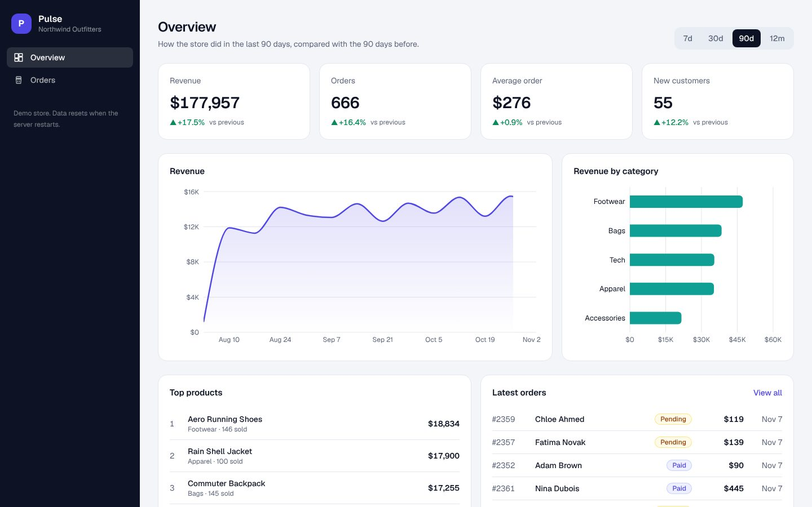

# Pulse: Next.js 16 Admin Dashboard (Postgres, Drizzle, Recharts)

A store analytics dashboard with real SQL behind every number: KPIs with "vs previous period", revenue and category charts, and an orders table with search, filters, sorting, pagination, CSV export and a "Mark shipped" action.

**[Live demo](https://pulse-dashboard-osama.vercel.app)** · **[Video tutorial](https://www.youtube.com/@osamaayubdev)** · MIT license



## Features

- **KPIs that compare:** revenue, orders, average order and new customers, each against the period before
- **Date ranges:** 7 days, 30 days, 90 days, 12 months, kept in the URL (`?range=90d`) so views can be shared
- **Charts:** revenue over time (daily, weekly or monthly buckets with gaps filled) and revenue by category
- **Orders table:** search by name, email or `#order`, filter by status, sort by date or total, 12 per page
- **Everything in SQL:** filtering, sorting and paging run in Postgres; the browser only gets one page
- **Mark shipped:** a Server Action with `useActionState`; the status check is inside the `UPDATE`, so double clicks are safe
- **CSV export** of the current filtered view, with formula-safe cells
- **Zero setup:** Postgres runs inside the app with PGlite (WebAssembly) and seeds a realistic year of orders
- Streaming with Suspense skeletons, security headers, keyboard focus styles, mobile layout

## Quick start

```bash
git clone https://github.com/osamaayub/pulse-dashboard.git
cd pulse-dashboard
npm install
npm run dev
```

Open http://localhost:3000. No database, keys or `.env` needed.

## How it works

```
Browser ── ?range=30d / ?q=ava&status=paid&page=2 ──▶ Server Component page
                                                          │ parse params with Zod (bad input → safe defaults)
                                                          ▼
                                             lib queries (Drizzle) ──▶ Postgres (PGlite)
                                                          │ Promise.all: all queries at once
                                                          ▼
                                     HTML streams in; charts hydrate as small client components
```

| Part | File |
| --- | --- |
| Tables (customers, products, orders, order items) | `src/server/schema.ts` |
| Database + seed, one per server instance | `src/server/db.ts`, `src/server/seed.ts` |
| All SQL (KPIs, series, categories, orders list) | `src/server/queries.ts` |
| "Mark shipped" Server Action | `src/server/actions.ts` |
| URL params, date windows, deltas | `src/lib/params.ts` |
| Pages | `src/app/page.tsx`, `src/app/orders/page.tsx` |
| Charts (Recharts, client) | `src/components/charts.tsx` |
| Debounced search that updates the URL | `src/components/search-box.tsx` |
| CSV export | `src/app/api/orders.csv/route.ts` |

Design rules:

- **The URL is the state.** Range, search, filter, sort and page live in the query string, so a refresh or a shared link shows the same view.
- **Only charts are client components.** Everything else renders on the server, so the page ships little JavaScript.
- **User input is parsed, never trusted.** Search params go through Zod with fallbacks; search terms are escaped for `ILIKE`.

## Use a real Postgres

PGlite keeps the demo free and setup-free, but its data lives in memory and resets on restart. For a real store, point Drizzle at Neon, Supabase or any Postgres in `src/server/db.ts` (`drizzle-orm/node-postgres` or `drizzle-orm/neon-http`). The queries don't change.

## Scripts

| Command | What it does |
| --- | --- |
| `npm run dev` | Development server |
| `npm test` | Vitest: param parsing, date windows, deltas, seed consistency |
| `npm run typecheck` | TypeScript check |
| `npm run build` | Production build |

## Practise

1. Add a Customers page with lifetime value per customer.
2. Add a date picker for a custom range.
3. Add sign-in so only admins see the dashboard.

## Stack

Next.js 16 (App Router, Cache Components, Server Actions), React 19, TypeScript, Tailwind CSS 4, Drizzle ORM, PGlite (Postgres), Recharts, Zod, Vitest.

## Author

Built by [Osama Ayub](https://github.com/osamaayub), full-stack developer (React, Next.js, Node.js, AI integration). Need a dashboard or internal tool? [Hire me on Upwork](https://www.upwork.com/freelancers/~01c0c3cf471b66a427).

## License

MIT
